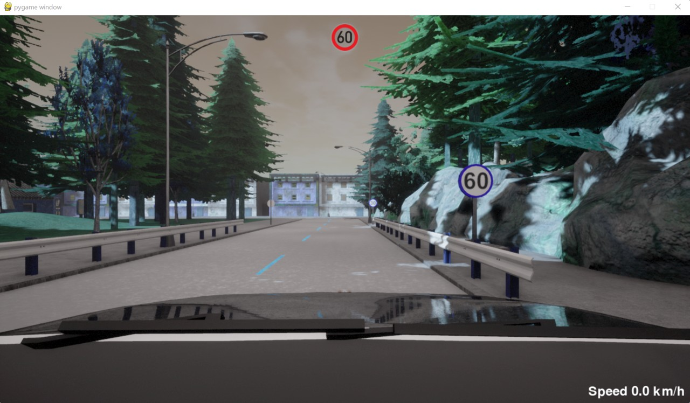
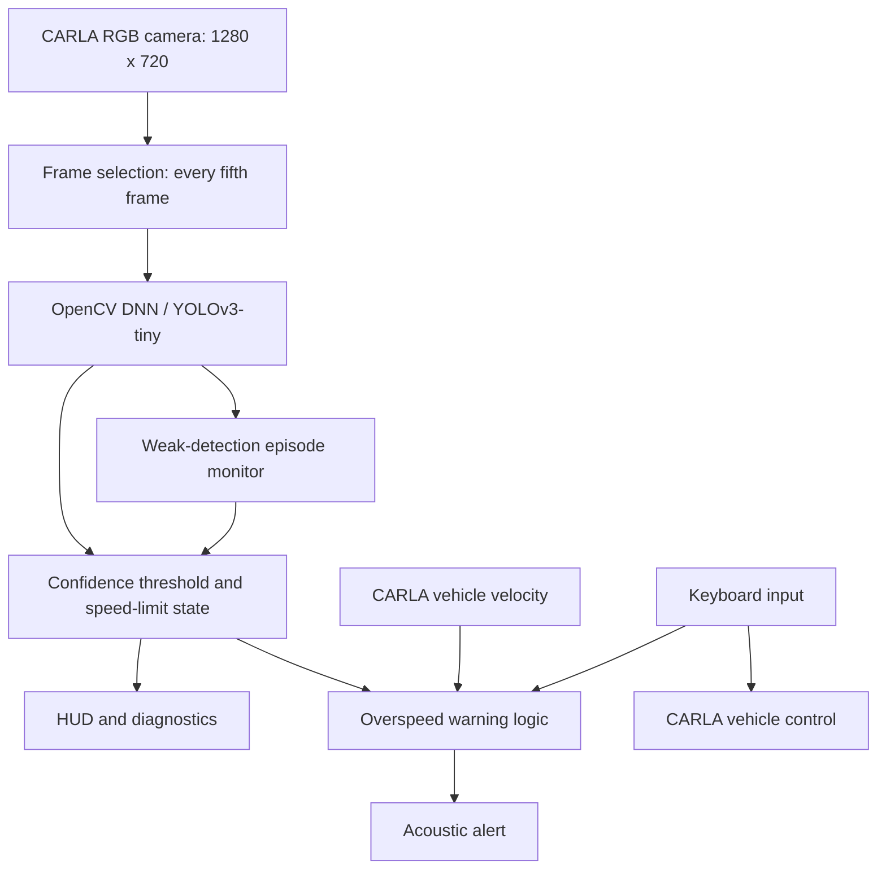
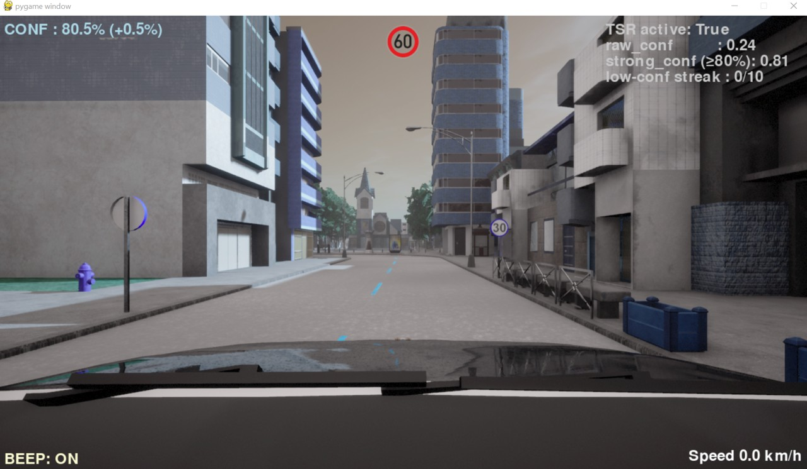

# Intelligent Speed Assistance in CARLA

**Camera-based traffic sign recognition and driver feedback using a custom YOLOv3-tiny detector.**

   

Developed by **Mohamed Amine GuezGuez** at Technische Hochschule Mittelhessen (THM), as part of the *Fahrerassistenzsysteme* (Driver Assistance Systems, II2511) course in 2025. The project integrates computer vision, simulation, human–machine interaction and requirements-based verification in an Intelligent Speed Assistance (ISA) prototype.



*Original simulation screenshot from the technical report (FR-01-1).*

## Overview

The system detects supported speed-limit signs from a simulated vehicle's forward-facing RGB camera, updates the displayed speed limit when detector confidence reaches 0.80, and provides an acoustic warning when the driver exceeds that limit. The assistance system does not automatically intervene in throttle or braking.

The project covers the complete prototype workflow: requirements specification, custom detector configuration and training, simulator integration, a driver-facing interface, and scenario-based evaluation.

### Key features

- Custom YOLOv3-tiny / Darknet detector for 30, 60 and 90 km/h signs, with three detection heads and 608 × 608 input.
- OpenCV DNN inference on every fifth camera frame; CPU execution in the supplied client.
- Confidence-gated speed-limit updates and a persistent head-up display (HUD).
- Continuous, driver-toggleable acoustic overspeed warning during manual driving.
- Weak-detection episode monitor designed to disable traffic-sign recognition after ten consecutive weak episodes.
- Separate user and developer modes, including bounding boxes and confidence diagnostics.
- Requirements specification, UML state-machine design and documented simulation test scenarios.

## System architecture



The perception and warning pipeline is advisory: driver control remains independent of the detected speed limit. The diagram represents the intended data flow; see [implementation notes](docs/implementation-notes.md) for limitations of the submitted snapshot.



*Original developer-mode screenshot (FR-05-1): a weak 30 km/h detection does not replace the active 60 km/h limit.*

## Technology stack

| Component | Technology |
| --- | --- |
| Simulation | CARLA 0.9.15, Unreal Engine |
| Programming | Python 3.7.16 |
| Object detection | Custom YOLOv3-tiny, Darknet configuration and weights |
| Inference and image processing | OpenCV DNN, NumPy |
| Driver interface | Pygame (HUD, keyboard control, audio) |
| System design and verification | Functional / non-functional requirements, UML, scenario-based testing |

## Evaluation (original project report)

The report describes a training split of 3,776 images, a validation split of 944 images, and a 1,180-frame test set (590 sign-containing frames and 590 without signs). The reported best checkpoint at 7,500 iterations achieved:

| Reported metric | Result |
| --- | ---: |
| mAP | 93.0% |
| IoU | 76.3% |
| F1-score | 0.94 |
| Per-class recognition (30 / 60 / 90 km/h) | 90.1% / 91.2% / 99.7% |
| GPU inference time (RTX 3070) | 8 ± 1 ms per analyzed frame |
| CPU inference time (8-core desktop) | 130 ± 10 ms per analyzed frame |

The final presentation reports 19 passed test cases, 2 failed, 1 passed with room for improvement, and 7 not feasible in CARLA. These are **historical results**, not measurements reproduced during repository cleanup. The bundled checkpoint is named `yolov3-tiny-obj_5000.weights`; its equivalence to the reported 7,500-iteration checkpoint is unverified. Training data, other checkpoints and the original evaluation scripts are not included. See [report, sections 3–6](docs/technical-report.pdf).

## Getting started

The original environment was Windows 10/11 with CARLA 0.9.15. Use a machine that can run the simulator and the matching Python API. A macOS host can be used for Git and repository editing; native CARLA execution is not established here. Python 3.7 is a legacy runtime retained for compatibility.

### 1. Prepare the Python environment

From the repository root in an Anaconda Prompt or compatible terminal:

```bash
conda env create -f environment.yml
conda activate carla_isa
python -m pip install -r requirements.txt
```

Install the Python wheel supplied with your CARLA 0.9.15 distribution. For example, on Windows (adjust the path to your installation):

```powershell
python -m pip install "C:\CARLA\WindowsNoEditor\PythonAPI\carla\dist\carla-0.9.15-cp37-cp37m-win_amd64.whl"
```

The wheel must match your OS, Python version and CARLA server. The simulator itself is not included; obtain the matching release from the [CARLA project](https://github.com/carla-simulator/carla/releases/tag/0.9.15).

### 2. Run the model smoke test (optional)

```bash
python scripts/smoke_test.py
```

This checks Python source syntax, required asset presence and a synthetic CPU forward pass through the bundled network. It does not require a running simulator and does not measure recognition accuracy.

### 3. Start CARLA and load the map

Start `CarlaUE4.exe` from the Windows CARLA installation. Wait for the simulator to finish loading, then run:

```bash
python src/change_map.py --town Town02
```

Wait for `Town loaded` before starting the driving client. A remote server can be specified via `--host` and `--port` on both scripts.

### 4. Start the driving client

```bash
# User mode
python src/manual_control.py

# Developer mode
python src/manual_control.py --developer
```

Run one client at a time. The bundled weights, configuration, icons and sound are located automatically relative to the source file.

| Key | Action |
| --- | --- |
| W / Up | Accelerate |
| S / Down | Brake |
| A / D or Left / Right | Steer |
| Q | Reverse gear |
| Space | Handbrake |
| N | Toggle acoustic warning |
| Esc / Ctrl+Q | Exit |

Restart the client to reset the recognition state. The submitted code also exposes an optional autopilot control, but warning behavior is designed for manual driving.

## Repository structure

```text
carla-intelligent-speed-assistance/
├── src/
│   ├── manual_control.py         # Camera, perception, HUD and driving client
│   └── change_map.py             # CARLA map-loading utility
├── models/                       # Darknet config and submitted trained weights
├── assets/                       # Speed-limit icons and acoustic warning
├── docs/
│   ├── images/                   # Original simulation screenshots
│   ├── technical-report.pdf      # Requirements, design and evaluation
│   ├── presentation.pdf          # Original project presentation
│   └── implementation-notes.md   # Snapshot caveats and verification status
├── scripts/
│   └── smoke_test.py              # Offline model and source checks
├── environment.yml               # Conda environment
├── requirements.txt              # Runtime dependencies (except CARLA wheel)
├── .gitignore
└── README.md
```

## Documentation

| Resource | Contents |
| --- | --- |
| [Technical report (PDF)](docs/technical-report.pdf) | Requirements, UML, detector design, implementation, experimental results and limitations |
| [Project presentation (PDF)](docs/presentation.pdf) | Project motivation, system design, demonstration and test outcomes |
| [Implementation notes](docs/implementation-notes.md) | Scope, known issues, historical results and repository verification |

## Limitations and future work

This is a simulation-only academic prototype, not a certified or production-ready automotive safety system. It supports three speed-limit classes and is tuned to the Mercedes coupe vehicle blueprint. It does not account for passing the physical sign before activating a limit. Adverse weather, night-time performance, real-world sensor behavior, functional safety and thermal requirements are not established. The original report also proposes cross-simulator evaluation and broader sign coverage.

## Attribution and reuse

Academic project by Mohamed Amine GuezGuez, THM (2025). Built with [CARLA](https://github.com/carla-simulator/carla), [Darknet / YOLO](https://pjreddie.com/darknet/yolo/), OpenCV and Pygame. The technical report includes the original bibliography. No repository-wide license has been assigned; third-party components retain their respective terms.
